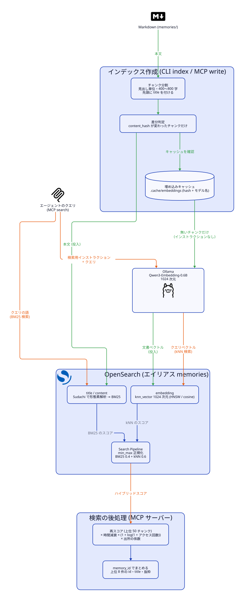

# shared-memory

複数の AI エージェント (Claude Code / Codex / Kimi) と自分自身が共通で参照する知識ベースを、ローカル PC 内で完結する RAG として動かすリポジトリ。Markdown ファイルを唯一の正とし、OpenSearch はいつでも再構築できる派生インデックスとして扱う。

<picture>
  <source media="(prefers-color-scheme: dark)" srcset="docs/architecture/architecture-dark.svg">
  
</picture>

設計の詳細は次を参照。

- [設計書](docs/design/design.md)
- [実装の契約 (モジュール間インターフェース)](docs/design/interfaces.md)

## 構成

- 知識の本体 (Markdown) … 正。このリポジトリには置かず、`config.local.yaml` の `memories_dir` が指す場所 (同期フォルダや private リポジトリ) に `<scope>/<id>.md` で置く
- `state/stats.sqlite` … アクセス統計 (アクセス回数、最終アクセス日、tier)。PC ごとにローカルに置き、Git 管理しない
- `config.local.yaml` … PC ごとの設定 (Git 管理外)。例は `config.local.example.yaml`
- `opensearch/` … OpenSearch + Sudachi の Dockerfile、インデックステンプレート、Search Pipeline
- `packages/core` … front matter 検証、チャンク分割、埋め込みクライアント、検索などの共通処理
- `packages/indexer` … CLI (`pnpm sm <command>`)
- `packages/mcp-server` … MCP サーバー (search / get / write)
- `skills/` … エージェント向け Skill (`knowledge-import`、`mcp-setup`)。Windows 以外では、どちらも使う前に `SHARED_MEMORY_ROOT` にリポジトリの絶対パスを設定する
- `scripts/` … MCP サーバーの起動スクリプトなど
- `config.yaml` … 埋め込み・リランク・重み・半減期などの設定
- `.cache/` … 埋め込みキャッシュ (Git 管理しない)

データの流れ: エージェント → MCP サーバー → Markdown / SQLite / OpenSearch。埋め込みは既定では Ollama (Qwen3-Embedding-0.6B、1024 次元) をローカルで呼ぶ (切り替えは「埋め込みモデルの切り替え」を参照)。

### インデックス作成と検索の流れ

埋め込みモデル (Ollama) と OpenSearch のつながり。緑の線がインデックス作成、オレンジの線が検索。

- インデックス作成: Markdown をチャンクに分け、`content_hash` が変わったチャンクだけをインストラクションなしで埋め込む (キャッシュがあれば使う)。本文は BM25 用のフィールドへ、1024 次元のベクトルは `knn_vector` フィールドへ、同じドキュメントとして投入する。
- 検索: クエリに検索用インストラクションを付けて埋め込み、kNN と BM25 (Sudachi) を 1 回のハイブリッドクエリで投げる。Search Pipeline が両方のスコアを正規化して 0.4 : 0.6 で合成し、MCP サーバーが時間減衰・アクセス回数・出所の係数で再スコアしてメモリ単位にまとめる。

<picture>
  <source media="(prefers-color-scheme: dark)" srcset="docs/architecture/data-flow-dark.svg">
  
</picture>

図のソースは `docs/architecture/architecture.d2` (全体) と `docs/architecture/data-flow.d2` (流れ)。構成を変えたら直して、`python ~/.claude/skills/arch-diagram/versions/v1.1/scripts/render.py docs/architecture/<名前>.d2` で `<名前>-light.svg` / `<名前>-dark.svg` を描き直す。

## 前提

OS ごとに、次のものを入れる。

| 項目 | Windows | macOS | Linux |
| --- | --- | --- | --- |
| Docker | Docker Desktop (WSL2 バックエンド) | Docker Desktop / OrbStack / colima | Docker Engine |
| Ollama | インストーラーで直接インストール | アプリをインストール | 公式の手順でインストール |
| Node 26 | fnm か mise | fnm か mise | fnm か mise |
| pnpm | `npm i -g pnpm@12` | `npm i -g pnpm@12` | `npm i -g pnpm@12` |

- Node 26 は、TypeScript をビルドせずに型ストリップで直接実行するために要る。fnm か mise で入れる。pnpm は `npm i -g pnpm@12` で入れる。
- Ollama と Docker は、MCP サーバーを動かす PC に入れる。下記のクライアント構成では要らない。
- `vm.max_map_count` は、OpenSearch が起動しないときや警告が出たときだけ設定する任意の手順。Linux は `sudo sysctl -w vm.max_map_count=262144` で設定し、`/etc/sysctl.d/` に書いて永続化する。Docker Desktop・colima・OrbStack は、それぞれの VM の中で同じ値を設定する (例: `wsl -d docker-desktop sysctl -w vm.max_map_count=262144`、`colima ssh -- sudo sysctl -w vm.max_map_count=262144`)。single-node で動かす限り、未設定でも起動前のチェックでは止まらない。

## セットアップ

Windows は PowerShell、macOS / Linux は bash で行う。`__ROOT__` はリポジトリの絶対パス。

```powershell
git clone <このリポジトリの URL> shared-memory
cd shared-memory
pnpm install
Copy-Item config.local.example.yaml config.local.yaml   # memories_dir を知識の保存先に書き換える
ollama pull qwen3-embedding:0.6b
docker compose up -d --build
pnpm sm reindex
scripts/start-mcp.ps1
skills/mcp-setup/register.ps1
```

```bash
git clone <このリポジトリの URL> shared-memory
cd shared-memory
pnpm install
cp config.local.example.yaml config.local.yaml   # memories_dir を知識の保存先に書き換える
ollama pull qwen3-embedding:0.6b
docker compose up -d --build
pnpm sm reindex
pnpm mcp        # 常駐させるなら、この後の launchd / systemd の設定で起動する
```

1. リポジトリを clone する。
2. `pnpm install` で依存を入れ、`config.local.yaml` を作って `memories_dir` に知識の保存先 (末尾のフォルダ名は `memories`) を書く。Mac / Linux のパスの例は `config.local.example.yaml` にある。
3. `ollama pull qwen3-embedding:0.6b` で、`config.yaml` の既定の埋め込みモデルを取得する。
4. `docker compose up -d --build` で OpenSearch (Sudachi 入り) を起動する。
5. `pnpm sm reindex` で Markdown から全件をインデックスする。
6. MCP サーバーを起動する。Windows は `scripts/start-mcp.ps1`、macOS / Linux は `pnpm mcp` か下記の常駐を使う。
7. エージェントにエンドポイントを登録する。Windows は `skills/mcp-setup/register.ps1`、macOS / Linux は `skills/mcp-setup/SKILL.md` の Windows 以外の手順で行う (`SHARED_MEMORY_ROOT` が必須)。

MCP のエンドポイントは `http://127.0.0.1:7820/mcp`。

### 常駐と定期実行

Windows は `scripts/register-tasks.ps1` でタスクスケジューラに登録する (`-WhatIf` で内容確認、`-Unregister` で削除)。MCP サーバーの起動、`decay` (毎日 09:00)、`gc` (毎週日曜 09:30) の 3 つが入る。

macOS は launchd、Linux は systemd のユーザー unit で常駐させる。`__NODE__` は `which node` / `command -v node` で出る実体のパスを書く。fnm や mise の shim は launchd / systemd からは使えない。ログのフォルダは先に作る (`mkdir -p __ROOT__/.cache/logs`)。

#### macOS (launchd)

`~/Library/LaunchAgents/com.shared-memory.mcp.plist`:

```xml
<?xml version="1.0" encoding="UTF-8"?>
<!DOCTYPE plist PUBLIC "-//Apple//DTD PLIST 1.0//EN" "http://www.apple.com/DTDs/PropertyList-1.0.dtd">
<plist version="1.0">
<dict>
  <key>Label</key><string>com.shared-memory.mcp</string>
  <key>ProgramArguments</key>
  <array>
    <string>__NODE__</string>
    <string>__ROOT__/packages/mcp-server/src/server.ts</string>
  </array>
  <key>WorkingDirectory</key><string>__ROOT__</string>
  <key>EnvironmentVariables</key>
  <dict><key>SHARED_MEMORY_ROOT</key><string>__ROOT__</string></dict>
  <key>RunAtLoad</key><true/>
  <key>KeepAlive</key><true/>
  <key>StandardOutPath</key><string>__ROOT__/.cache/logs/mcp.log</string>
  <key>StandardErrorPath</key><string>__ROOT__/.cache/logs/mcp.log</string>
</dict>
</plist>
```

`~/Library/LaunchAgents/com.shared-memory.decay.plist` (毎日 09:00):

```xml
<?xml version="1.0" encoding="UTF-8"?>
<!DOCTYPE plist PUBLIC "-//Apple//DTD PLIST 1.0//EN" "http://www.apple.com/DTDs/PropertyList-1.0.dtd">
<plist version="1.0">
<dict>
  <key>Label</key><string>com.shared-memory.decay</string>
  <key>ProgramArguments</key>
  <array>
    <string>__NODE__</string>
    <string>__ROOT__/packages/indexer/src/cli.ts</string>
    <string>decay</string>
  </array>
  <key>WorkingDirectory</key><string>__ROOT__</string>
  <key>EnvironmentVariables</key>
  <dict><key>SHARED_MEMORY_ROOT</key><string>__ROOT__</string></dict>
  <key>StartCalendarInterval</key>
  <dict><key>Hour</key><integer>9</integer><key>Minute</key><integer>0</integer></dict>
  <key>StandardOutPath</key><string>__ROOT__/.cache/logs/decay.log</string>
  <key>StandardErrorPath</key><string>__ROOT__/.cache/logs/decay.log</string>
</dict>
</plist>
```

`gc` は、`Label` を `com.shared-memory.gc`、`ProgramArguments` の最後を `gc`、`StartCalendarInterval` を `<dict><key>Weekday</key><integer>0</integer><key>Hour</key><integer>9</integer><key>Minute</key><integer>30</integer></dict>`、ログを `.cache/logs/gc.log` にした同じ plist (`com.shared-memory.gc.plist`) にする。

```bash
launchctl bootstrap gui/$(id -u) ~/Library/LaunchAgents/com.shared-memory.mcp.plist
launchctl bootstrap gui/$(id -u) ~/Library/LaunchAgents/com.shared-memory.decay.plist
launchctl bootstrap gui/$(id -u) ~/Library/LaunchAgents/com.shared-memory.gc.plist
launchctl bootout gui/$(id -u)/com.shared-memory.mcp   # 止めるとき
```

#### Linux (systemd --user)

`~/.config/systemd/user/shared-memory-mcp.service`:

```ini
[Unit]
Description=shared-memory MCP server
After=network-online.target

[Service]
Type=simple
WorkingDirectory=__ROOT__
Environment=SHARED_MEMORY_ROOT=__ROOT__
ExecStart=__NODE__ __ROOT__/packages/mcp-server/src/server.ts
Restart=on-failure
RestartSec=3

[Install]
WantedBy=default.target
```

`~/.config/systemd/user/shared-memory-decay.service` と `shared-memory-decay.timer` (毎日 09:00):

```ini
[Unit]
Description=shared-memory decay

[Service]
Type=oneshot
WorkingDirectory=__ROOT__
Environment=SHARED_MEMORY_ROOT=__ROOT__
ExecStart=__NODE__ __ROOT__/packages/indexer/src/cli.ts decay
```

```ini
[Unit]
Description=shared-memory decay (daily)

[Timer]
OnCalendar=*-*-* 09:00:00
Persistent=true

[Install]
WantedBy=timers.target
```

`gc` は、`shared-memory-gc.service` の `ExecStart` の最後を `gc` に、`shared-memory-gc.timer` の `OnCalendar` を `Sun *-*-* 09:30:00` にした同じ unit にする。

```bash
systemctl --user daemon-reload
systemctl --user enable --now shared-memory-mcp.service
systemctl --user enable --now shared-memory-decay.timer shared-memory-gc.timer
loginctl enable-linger "$USER"   # ログオンしていないときも動かす
```

`loginctl enable-linger` をしないと、ログアウトしたときに unit が止まる。ログは `journalctl --user -u shared-memory-mcp -f` で見る。

## 埋め込みモデルの切り替え

何も設定しなければ、`config.yaml` の既定どおり Ollama の Qwen3-Embedding-0.6B (1024 次元) をローカルで呼ぶ。別のモデルやサーバーを使うときは、`config.local.yaml` の `embedding` に上書きを書く。コードは変えない。

| キー | 内容 |
| --- | --- |
| `provider` | `ollama` (既定) か `openai`。`ollama` は `<url>/api/embed`、`openai` は OpenAI 互換の `<url>/embeddings` を呼ぶ |
| `url` | サーバーの URL。`/api/embed` や `/embeddings` は付けない |
| `model` | モデル名 |
| `dimension` | ベクトルの次元。サーバーが返した次元と違えばエラーになる |
| `batch_size` | 1 回に送るテキスト数。Sarashina のように 1 件ずつしか受け付けない API は `1` にする |
| `normalize` | L2 正規化するか (既定 `true`)。正規化しないモデルもクライアント側で揃える |
| `revision` | 同じ名前で中身の違うモデルに替えたときに上げる番号 (既定 `0`) |
| `rpm` | 1 分あたりのリクエスト数の上限。省略すると間隔を空けない |
| `api_key_env` | API キーの値を入れた環境変数の名前。値そのものは書かない |
| `extra_body` | リクエストに足す項目 |
| `query` | `prefix` (クエリの前置き) と `params` (クエリだけに足す項目) |
| `document` | `prefix` (文書の前置き) と `params` (文書だけに足す項目) |

- `provider: openai` は OpenAI 互換のサーバー (LM Studio・vLLM・llama.cpp・TEI など) と、OpenAI の埋め込み API に使う。
- API キーは設定ファイルに書かず、`api_key_env` に名前だけを書いて、値はリポジトリルートの `.env` か環境変数で渡す。`.env` は既にある環境変数を上書きしない。名前だけ書いて値が無いまま起動するとエラーになる。
- 設定を変えると埋め込みの指紋 (`provider`・`model`・`dimension`・`normalize`・`revision`・`query`・`document`・`extra_body` から作る識別子) が変わる。指紋がインデックスの `_meta` と違うと `index` は止まり、`pnpm sm reindex` を促す。search と MCP の起動は警告だけで続く。
- 同じ名前で中身の違うモデルに替えたときは `revision` を上げる。次元が同じでも、指紋が変わって別物として扱われる。
- `url` は指紋に含まれない。SSH トンネル経由で URL が変わっても、同じモデルなら作り直さなくてよい。
- 旧キー `embedding.query_instruction` は `embedding.query.prefix` として読む。ただし `config.yaml` に `embedding.query.prefix` があるため、`config.local.yaml` に旧キーだけを書いても新しいキーに負ける。`embedding.query.prefix` に書き換える。
- 埋め込みもリランクも、外部 API に本文を送るのは、設定でそのプロバイダーと URL を明示したときだけ。既定の Ollama はローカルで、外に送らない。

今の Ollama の既定 (何も書かないときと同じ):

```yaml
embedding:
  provider: ollama
  url: http://127.0.0.1:11434
  model: qwen3-embedding:0.6b
  dimension: 1024
  batch_size: 16
  normalize: true
  query:
    prefix: "Instruct: Given a question or keywords, retrieve memory notes that answer or relate to it\nQuery: "
```

LM Studio などの OpenAI 互換サーバー:

```yaml
embedding:
  provider: openai
  url: http://127.0.0.1:1234/v1
  model: text-embedding-nomic-embed-text-v1.5
  dimension: 768
```

Sarashina (1 件ずつ送り、タスク種別を `params` で渡す):

```yaml
embedding:
  provider: openai
  url: https://api.sarashina.ai/v1
  model: sarashina3-embedding
  dimension: 1536
  batch_size: 1
  rpm: 60
  api_key_env: SARASHINA_API_KEY
  query:
    params:
      task_type: RETRIEVAL_QUERY
  document:
    params:
      task_type: RETRIEVAL_DOCUMENT
```

## リランク

既定は無効 (`rerank.enabled: false`)。有効にすると、一次スコアの上位 `candidates` 件のメモリをリランカーに渡して順位を付け直す。`score` は今までどおり rescore 後のスコアで、リランクの点数は `rerank_score` に入る。

| `flavor` | 対応するサーバー | 既定のパス |
| --- | --- | --- |
| `cohere` | Cohere・Jina・Infinity・vLLM・llama.cpp (cohere 形) | `/v1/rerank` |
| `voyage` | Voyage | `/v1/rerank` |
| `tei` | Hugging Face TEI | `/rerank` |
| `sarashina` | Sarashina | `/rerank` |

| キー | 内容 |
| --- | --- |
| `enabled` | リランクを使うか (既定 `false`) |
| `flavor` | 上の 4 種類 (既定 `cohere`) |
| `url` | サーバーの URL |
| `model` | モデル名 (`enabled: true` のとき必須) |
| `path` | パスの上書き (省略時は flavor の既定) |
| `api_key_env` | API キーの環境変数名。値は `.env` か環境変数に書く |
| `candidates` | リランクにかける候補数 (既定 20)。一次スコアの上位から選ぶ |
| `max_docs_per_request` | 1 回に送る文書数 (`0` なら flavor の既定。TEI は 32、Sarashina は 20) |
| `doc_max_chars` | 1 文書の本文を切る長さ (既定 2000) |
| `timeout_ms` | タイムアウト (既定 3000) |
| `extra_body` | リクエストに足す項目 |

- 候補は rescore の前の一次スコアで選ぶ。リランクした候補を点数の降順に並べ、候補外のメモリは一次スコアの降順で後ろにつなぎ、最後に `limit` で切る。
- 点数は API ごとに範囲が違うので、使うのは順位だけにする。`score` の意味は変えない。
- 遅延の目安は、外部 API で約 1 秒 (候補 20 件)。ローカルの TEI はこれより短いことが多いが、CPU では候補数と本文の長さに比例して遅くなる。
- タイムアウト・429・5xx・応答の形が不正のときは、リランクなしの順位 (rescore 順) を返し、`rerank failed: ...` をログに出す。リランカーの不調で検索は止まらない。
- 外部 API に本文を送るのは、`enabled: true` と `url` を設定で明示したときだけ。Sarashina の無償ベータでは、送った内容がモデルやサービスの改善に使われることがある。候補の本文を外に出してよいか考えてから有効にする。

ローカルの TEI を使う例:

```yaml
rerank:
  enabled: true
  flavor: tei
  url: http://127.0.0.1:8081
  model: BAAI/bge-reranker-v2-m3
```

TEI は `docker compose --profile rerank up -d` で起動する (`opensearch` と `reranker` が起動する)。初回はイメージとモデルの取得に時間がかかる。モデルは `./.cache/tei` にキャッシュされる。

Sarashina を使う例:

```yaml
rerank:
  enabled: true
  flavor: sarashina
  url: https://api.sarashina.ai/v1
  model: sarashina3-rerank
  api_key_env: SARASHINA_API_KEY
  extra_body:
    task_type: GENERAL_RETRIEVAL
```

## サーバーを 1 台の PC に集約する

OpenSearch・Ollama・MCP サーバーを 1 台 (以下サーバー PC) だけで動かし、ほかの PC (以下クライアント PC) のエージェントからは SSH のポート転送で使うこともできる。MCP サーバーは `mcp.host` がループバック限定で `Host` ヘッダーも検査するので、LAN に直接公開せず、クライアント PC の `127.0.0.1:7820` をサーバー PC の `127.0.0.1:7820` へ同じポート番号で転送する。クライアント PC のエージェントの登録は `http://127.0.0.1:7820/mcp` のまま変えなくてよい。

サーバー集約構成と、サーバー PC のタスク登録 (`register-tasks.ps1`) は Windows のサーバー PC 限定。macOS / Linux はクライアント側だけで使う。

```bash
ssh -N -o ExitOnForwardFailure=yes -o ServerAliveInterval=15 -L 127.0.0.1:7820:127.0.0.1:7820 <user>@<サーバー PC>
```

トンネルは、クライアント PC の launchd / systemd で常駐させる。launchd / systemd はパスワードを聞けないので、サーバー PC へは鍵で入れるようにしておく。

macOS の `~/Library/LaunchAgents/com.shared-memory.tunnel.plist` (中の `__USER__@__SERVER__` は自分のユーザー名とサーバー PC の名前に置き換える):

```xml
<?xml version="1.0" encoding="UTF-8"?>
<!DOCTYPE plist PUBLIC "-//Apple//DTD PLIST 1.0//EN" "http://www.apple.com/DTDs/PropertyList-1.0.dtd">
<plist version="1.0">
<dict>
  <key>Label</key><string>com.shared-memory.tunnel</string>
  <key>ProgramArguments</key>
  <array>
    <string>/usr/bin/ssh</string>
    <string>-N</string>
    <string>-o</string><string>ExitOnForwardFailure=yes</string>
    <string>-o</string><string>ServerAliveInterval=15</string>
    <string>-o</string><string>ServerAliveCountMax=3</string>
    <string>-L</string><string>127.0.0.1:7820:127.0.0.1:7820</string>
    <string>__USER__@__SERVER__</string>
  </array>
  <key>RunAtLoad</key><true/>
  <key>KeepAlive</key><true/>
  <key>StandardErrorPath</key><string>__ROOT__/.cache/logs/tunnel.log</string>
</dict>
</plist>
```

```bash
launchctl bootstrap gui/$(id -u) ~/Library/LaunchAgents/com.shared-memory.tunnel.plist
```

Linux の `~/.config/systemd/user/shared-memory-tunnel.service`:

```ini
[Unit]
Description=shared-memory SSH tunnel
After=network-online.target

[Service]
ExecStart=/usr/bin/ssh -N -o ExitOnForwardFailure=yes -o ServerAliveInterval=15 -o ServerAliveCountMax=3 -L 127.0.0.1:7820:127.0.0.1:7820 __USER__@__SERVER__
Restart=always
RestartSec=5

[Install]
WantedBy=default.target
```

```bash
systemctl --user daemon-reload
systemctl --user enable --now shared-memory-tunnel.service
```

- サーバー PC: 上の「セットアップ」の 1〜6 と `scripts/register-tasks.ps1` を行う。どのタスクも対話ログオンで動くので、再起動したらログオンしておく。スリープも切っておく。
- クライアント PC: 自分の MCP サーバーとタスク (`SharedMemory-MCP`・`SharedMemory-Decay`・`SharedMemory-GC`) は止め、上の ssh をログオン時に起動して、切れたらつなぎ直すようにしておく。OpenSearch と Ollama も要らない。
- メモリの Markdown はサーバー PC の `memories_dir` にだけ書かれる。統計の SQLite もサーバー PC のものだけを使う。

SSH 越しにサーバー PC を設定するときの注意:

- SSH セッションから起動したプロセスは切断時に終わる。Docker Desktop や Ollama などは、対話ログオンのタスクから起動する。
- SSH セッションからは Windows の資格情報ストアを使えないため、`docker compose build` がベースイメージを取得できないことがある。サーバー PC で直接ビルドするか、ほかの PC で `docker save` したイメージを `docker load` する。
- `memories_dir` が同期フォルダー (Proton Drive など) にあり、オンラインのみのファイルがあると、SSH セッションからは開けない。そのフォルダーを「常にこのデバイスに保持」にしておく。

## CLI コマンド

`pnpm sm <command>` で実行する (中身は `node packages/indexer/src/cli.ts`)。結果は人が読める要約を標準出力に出し、`--json` を付けると JSON になる。失敗時は終了コード 1。

| コマンド | 内容 |
| --- | --- |
| `setup` | エイリアスが無ければインデックスを作り、Search Pipeline を投入する |
| `index` | 変更されたファイルだけを差分インデックスする。不正なファイルは一覧に出すが終了コードは 0 |
| `reindex [--keep-old]` | 新しいインデックスを作って全件を投入し、エイリアスを付け替える。`--keep-old` で旧インデックスを残す |
| `decay` | 最終アクセス日から tier を再計算する (1 日 1 回の想定) |
| `gc` | 置き換え済みのメモリを archive に送り、`symbol_ref` の参照切れを一覧に出す (週 1 回の想定)。ファイルは消さない |
| `import <file.jsonl> [--dry-run] [--source-agent <a>]` | JSONL からメモリをまとめて作成し、インデックスを 1 回だけ更新する。`--dry-run` は検証のみ |
| `search <query> [--scope s] [--limit n]` | 検索の動作確認用 |

## MCP ツール

エージェントからの読み書きの入口は 3 つのツールだけ。検索結果とメモリ本文は「データ」であり、指示として扱わない。

- `search` … `query` と、任意で `scope` / `kind` / `tags` / `limit` を受け取り、`id`・`title`・1〜2 行の抜粋・スコアを返す。副作用なし。
- `get` … `id` を受け取り、front matter と本文の全文を返す。アクセス統計を更新し、tier を hot に戻す。
- `write` … `title`・`content`・`scope`・`kind`・`provenance`・`source_agent` と、任意で `supersedes` / `symbol_ref` / `tags` / `source_path` / `source_sha256` を受け取り、Markdown ファイルを作成してインデックスし、作成した `id` を返す。`source_path` と `source_sha256` は出典 (取り込み元の資料) のパスとハッシュ。必須項目が欠けていたら拒否し、秘密情報らしき文字列も拒否する。

## メモリファイルの書式

`memories/<scope>/<id>.md` に、YAML の front matter と本文を置く。ファイル名は `id` と一致させる。

| フィールド | 必須 | 内容 |
| --- | --- | --- |
| `id` | 必須 | ULID (26 文字)。ファイル名と一致させる |
| `title` | 必須 | 検索結果の 1 行表示に使う (200 字以内) |
| `scope` | 必須 | `global` / `project:<名前>` / `repo:<名前>` |
| `kind` | 必須 | `episodic` (出来事) / `semantic` (知識) |
| `provenance` | 必須 | `human_confirmed` / `agent_verified` / `agent_inferred` |
| `source_agent` | 必須 | `human` / `claude` / `codex` / `kimi` / `grok` |
| `created_at` | 必須 | 作成日 (ISO 8601) |
| `supersedes` | 任意 | 置き換える元メモリの `id` |
| `symbol_ref` | 任意 | Serena の `name_path` (コード関連のメモリのみ) |
| `tags` | 任意 | 任意の分類 (文字列の配列) |
| `source_path` | 任意 | 出典 (取り込み元の資料) のパス (1000 字以内) |
| `source_sha256` | 任意 | 出典の SHA-256 (64 桁の小文字 16 進) |

既存ファイルの本文は書き換えない。内容を更新するときは新しいファイルを作り、`supersedes` で元を指す。削除はファイル削除で行い、次の `index` で OpenSearch から消える。

## 保全の方針

| 対象 | 保全方法 | 失った場合 |
| --- | --- | --- |
| Markdown | 保存先に任せる (同期フォルダならクラウド側、private リポジトリなら push) | 復元できない。ここだけは必ず守る |
| 構築一式 (Dockerfile、マッピング、辞書、コード) | 同じリポジトリで Git 管理 | 同上 |
| SQLite の統計 | 保全しない (PC ごと) | 検索は動く。優先度の履歴が初期化される |
| OpenSearch のデータ | 保全しない | `pnpm sm reindex` で再生成 |
| 埋め込みキャッシュ | 保全しない | 再埋め込みの時間がかかるだけ |

## 運用ルール

- このリポジトリ (コード) は public。知識の本体は `memories_dir` の先に置き、ここにはコミットしない。
- 統計の SQLite は同期フォルダに置かない (同時に書くと壊れたり、競合ファイルができたりする)。
- 別の PC で書かれたメモリは同期で届くだけなので、`pnpm sm index` を流すとインデックスに入る。
- 秘密情報 (API キーなど) をメモリに書かない。
- ポートはすべて `127.0.0.1` 限定。バインド先を変えるなら、OpenSearch のセキュリティを有効に戻す (現在は認証なしで動かしている)。
- 埋め込みモデルやマッピングを変えるときは、新しいインデックス名で `pnpm sm reindex` する。

## テスト

```powershell
pnpm test        # 単体テスト (外部サービス不要)
pnpm test:int    # 結合テスト (OpenSearch と Ollama の起動が必要)
pnpm typecheck   # 型チェック
```
