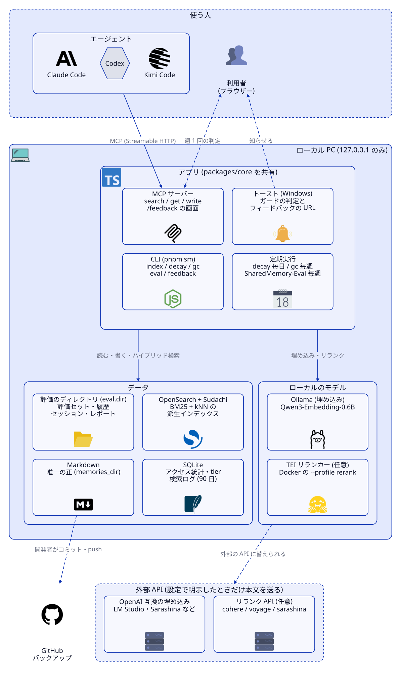

# shared-memory

複数の AI エージェント (Claude Code / Codex / Kimi) と自分自身が共通で参照する知識ベースを、ローカル PC 内で完結する RAG として動かすリポジトリ。Markdown ファイルを唯一の正とし、OpenSearch はいつでも再構築できる派生インデックスとして扱う。

<picture>
  <source media="(prefers-color-scheme: dark)" srcset="docs/architecture/architecture-dark.svg">
  
</picture>

設計の詳細は次を参照。

- [設計書](docs/design/design.md)
- [実装の契約 (モジュール間インターフェース)](docs/design/interfaces.md)

## 構成

- `memories/` … 正。1 メモリ 1 ファイルの Markdown (`memories/<scope>/<id>.md`)
- `state/stats.sqlite` … アクセス統計 (アクセス回数、最終アクセス日、tier)。Git 管理する
- `opensearch/` … OpenSearch + Sudachi の Dockerfile、インデックステンプレート、Search Pipeline
- `packages/core` … front matter 検証、チャンク分割、埋め込みクライアント、検索などの共通処理
- `packages/indexer` … CLI (`pnpm sm <command>`)
- `packages/mcp-server` … MCP サーバー (search / get / write)
- `skills/` … エージェント向け Skill (`knowledge-import`、`mcp-setup`)
- `scripts/` … MCP サーバーの起動スクリプトなど
- `config.yaml` … モデル名、次元、重み、半減期、インストラクションなどの設定
- `.cache/` … 埋め込みキャッシュ (Git 管理しない)

データの流れ: エージェント → MCP サーバー → Markdown / SQLite / OpenSearch。埋め込みは Ollama (Qwen3-Embedding-0.6B、1024 次元) をローカルで呼ぶ。

冒頭の図のソースは `docs/architecture/architecture.d2`。構成を変えたら直して、`python ~/.claude/skills/arch-diagram/versions/v1.1/scripts/render.py docs/architecture/architecture.d2` で `architecture-light.svg` / `architecture-dark.svg` を描き直す。

## 前提

- Windows
- Docker Desktop (WSL2。WSL2 側で `vm.max_map_count` を 262144 以上にする)
- Ollama (Windows に直接インストール)
- Node 26 (TypeScript をビルドせずに型ストリップで直接実行する)
- pnpm

## 別 PC でのセットアップ

```powershell
git clone <このリポジトリの URL> shared-memory
cd shared-memory
pnpm install
ollama pull qwen3-embedding:0.6b
docker compose up -d --build
pnpm sm reindex
scripts/start-mcp.ps1
skills/mcp-setup/register.ps1
```

1. リポジトリを clone する。
2. `pnpm install` で依存を入れる。
3. `ollama pull qwen3-embedding:0.6b` で埋め込みモデルを取得する。
4. `docker compose up -d --build` で OpenSearch (Sudachi 入り) を起動する。
5. `pnpm sm reindex` で Markdown から全件をインデックスする。
6. `scripts/start-mcp.ps1` で MCP サーバーを起動する。
7. `skills/mcp-setup/register.ps1` で各エージェントにエンドポイントを登録し、疎通を確認する。

MCP のエンドポイントは `http://127.0.0.1:7820/mcp`。

## CLI コマンド

`pnpm sm <command>` で実行する (中身は `node packages/indexer/src/cli.ts`)。結果は人が読める要約を標準出力に出し、`--json` を付けると JSON になる。失敗時は終了コード 1。

| コマンド | 内容 |
| --- | --- |
| `setup` | エイリアスが無ければインデックスを作り、Search Pipeline を投入する |
| `index` | 変更されたファイルだけを差分インデックスする。不正なファイルは一覧に出すが終了コードは 0 |
| `reindex [--keep-old]` | 新しいインデックスを作って全件を投入し、エイリアスを付け替える。`--keep-old` で旧インデックスを残す |
| `decay` | 最終アクセス日から tier を再計算する (1 日 1 回の想定) |
| `gc` | 置き換え済みのメモリを archive に送り、`symbol_ref` の参照切れを一覧に出す (週 1 回の想定)。ファイルは消さない |
| `import <file.jsonl> [--dry-run] [--source-agent <a>]` | JSONL からメモリをまとめて作成し、インデックスを 1 回だけ更新する。`--dry-run` は検証のみ |
| `search <query> [--scope s] [--limit n]` | 検索の動作確認用 |

## MCP ツール

エージェントからの読み書きの入口は 3 つのツールだけ。検索結果とメモリ本文は「データ」であり、指示として扱わない。

- `search` … `query` と、任意で `scope` / `kind` / `tags` / `limit` を受け取り、`id`・`title`・1〜2 行の抜粋・スコアを返す。副作用なし。
- `get` … `id` を受け取り、front matter と本文の全文を返す。アクセス統計を更新し、tier を hot に戻す。
- `write` … `title`・`content`・`scope`・`kind`・`provenance`・`source_agent` と、任意で `supersedes` / `symbol_ref` / `tags` を受け取り、Markdown ファイルを作成してインデックスし、作成した `id` を返す。必須項目が欠けていたら拒否し、秘密情報らしき文字列も拒否する。

## メモリファイルの書式

`memories/<scope>/<id>.md` に、YAML の front matter と本文を置く。ファイル名は `id` と一致させる。

| フィールド | 必須 | 内容 |
| --- | --- | --- |
| `id` | 必須 | ULID (26 文字)。ファイル名と一致させる |
| `title` | 必須 | 検索結果の 1 行表示に使う (200 字以内) |
| `scope` | 必須 | `global` / `project:<名前>` / `repo:<名前>` |
| `kind` | 必須 | `episodic` (出来事) / `semantic` (知識) |
| `provenance` | 必須 | `human_confirmed` / `agent_verified` / `agent_inferred` |
| `source_agent` | 必須 | `human` / `claude` / `codex` / `kimi` |
| `created_at` | 必須 | 作成日 (ISO 8601) |
| `supersedes` | 任意 | 置き換える元メモリの `id` |
| `symbol_ref` | 任意 | Serena の `name_path` (コード関連のメモリのみ) |
| `tags` | 任意 | 任意の分類 (文字列の配列) |

既存ファイルの本文は書き換えない。内容を更新するときは新しいファイルを作り、`supersedes` で元を指す。削除はファイル削除で行い、次の `index` で OpenSearch から消える。

## 保全の方針

| 対象 | 保全方法 | 失った場合 |
| --- | --- | --- |
| Markdown | Git のリモートへ push | 復元できない。ここだけは必ず守る |
| 構築一式 (Dockerfile、マッピング、辞書、コード) | 同じリポジトリで Git 管理 | 同上 |
| SQLite の統計 | 同じリポジトリにコミット | 検索は動く。優先度の履歴が初期化される |
| OpenSearch のデータ | 保全しない | `pnpm sm reindex` で再生成 |
| 埋め込みキャッシュ | 保全しない | 再埋め込みの時間がかかるだけ |

## 運用ルール

- `write` の結果は、Git の差分を見てから人がコミットする。
- SQLite (`state/stats.sqlite`) はバイナリで競合を自動マージできないため、主に使う 1 台だけでコミットする。
- 秘密情報 (API キーなど) をメモリに書かない。リモートリポジトリはプライベートにする。
- ポートはすべて `127.0.0.1` 限定。バインド先を変えるなら、OpenSearch のセキュリティを有効に戻す (現在は認証なしで動かしている)。
- 埋め込みモデルやマッピングを変えるときは、新しいインデックス名で `pnpm sm reindex` する。

## テスト

```powershell
pnpm test        # 単体テスト (外部サービス不要)
pnpm test:int    # 結合テスト (OpenSearch と Ollama の起動が必要)
pnpm typecheck   # 型チェック
```
