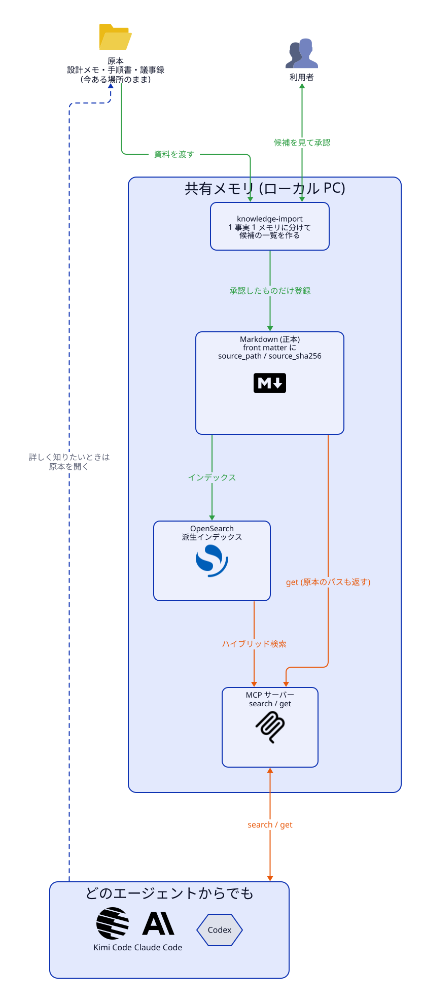
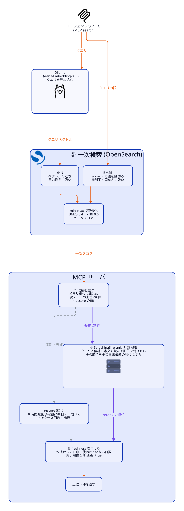
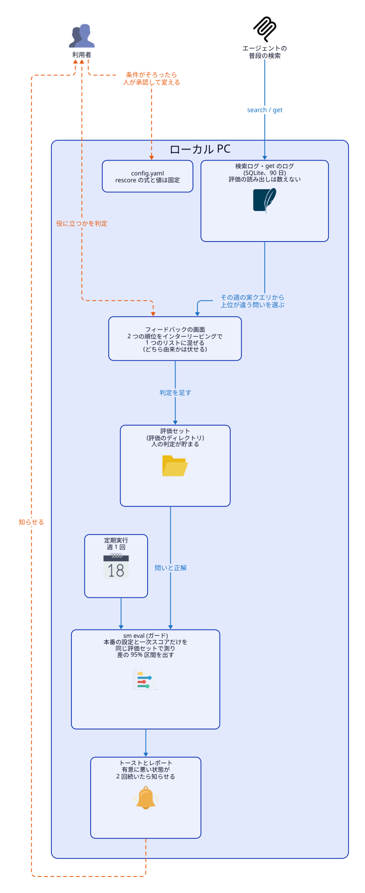

# ローカル RAG でナレッジを集約するスキルの開発と、Sarashina による Rerank

Claude Code・Codex・Kimi など、複数の AI エージェントと自分が同じ知識を読み書きできる「共有メモリ」を、ローカル PC だけで動く RAG として作っています。エージェントの覚え書きの置き場であると同時に、自分の資料をしまっておく保管庫でもあり、そこに入れた知識をどのエージェントからでも引けます。この記事では、まず仕組みとその形にした理由を説明します。次に、検索の設定を十数通り比べて、Sarashina3 rerank で検索の順位が大きく良くなった結果と、それをどう組み込んだかを書きます。

## この記事を読む前に (用語集)

記事に出てくる順に並べました。★ はこの仕組みに固有の言葉です。

### 前提となる言葉

| 用語 | 意味 |
| --- | --- |
| **RAG** | 質問に関係する資料を検索し、その資料を AI に渡して答えさせる仕組み。答えの質は検索の質で決まる |
| **MCP** | AI エージェントが外部のツールを呼ぶための共通の約束事。この記事では、エージェントがメモリを `search` / `get` / `write` する窓口 |
| **AI エージェント** | Claude Code・Codex・Kimi のように、自分でツールを使いながら作業する AI。ここではメモリの読み手であり書き手でもある |

### Shared Memory の仕組み

| 用語 | 意味 |
| --- | --- |
| ★ **メモリ** | 1 つの事実や出来事を書いた Markdown ファイル 1 つ。「ノート」に近い |
| ★ **正本** | 失ったら元に戻せない唯一の原本。ここでは Markdown のメモリだけが正本 |
| ★ **派生インデックス** | 正本からいつでも作り直せる検索用のデータ (OpenSearch)。消えても `reindex` で戻る |
| ★ **チャンク** | メモリを検索しやすい長さに分けた断片。検索の最小単位 |
| ★ **出所 (provenance)** | そのメモリの確かさ。人が確認した / エージェントが確かめた / 推測、の 3 段階 |
| ★ **出典 (原本)** | メモリを切り出した元の資料。メモリは原本のパス (`source_path`) とハッシュ (`source_sha256`) を持ち、そこから原本を開ける |
| ★ **knowledge-import** | 手元の資料をメモリに分けて取り込むための、エージェント向けのスキル |
| ★ **tier** | メモリがどれくらい使われていないかの段階。最終アクセスから 7 日で hot → warm、30 日で cold、180 日で archive になる |
| **忘却曲線** | 時間がたつほど記憶が薄れていく様子を表す曲線。ここでは「古いメモリほど検索の点数を少し下げる」仕組みのことを指す |
| **半減期** | 点数を下げる係数が半分になるまでの日数。長いほどゆっくり忘れる |
| ★ **古い記憶 (freshness)** | 作成から一定の日数がたったメモリ。検索からは隠さず、「古い」という印を付けて返す |

### 検索の言葉

| 用語 | 意味 |
| --- | --- |
| **BM25** | 語が一致するかで探す、昔からある全文検索。`pnpm` のような識別子や固有名に強い |
| **Sudachi** | 日本語の文を単語に区切る形態素解析器。BM25 で日本語を扱うために使う |
| **埋め込み (embedding)** | 文の意味を数字の並び (ベクトル) に変えること。意味が近い文はベクトルも近くなる |
| **kNN (ベクトル検索)** | 埋め込みが近い順に探す検索。言い換えに強い |
| **ハイブリッド検索** | BM25 と kNN の両方で探し、点数を合わせて順位を決める方法 |
| **正規化 (min_max / z_score)** | BM25 と kNN では点数の物差しが違うので、同じ物差しに揃えてから合成する |
| **RRF** | 点数を使わず、それぞれの順位だけで合成する方法 |
| ★ **一次スコア** | ハイブリッド検索が返す点数 |
| ★ **rescore** | 一次スコアに「最近読まれたか・よく読まれるか・出所」の係数を掛ける、この仕組み独自の補正 |
| **リランク / リランカー** | 上位の候補とクエリを専用のモデルに読ませ、順位を付け直すこと / それをするモデル。検索より重いが、より精密に判断する |
| ★ **候補** | リランクにかける上位のメモリ (ここでは 20 件) |
| **Sarashina3 rerank** | SB Intuitions が提供する、日本語に強いリランカー (API で呼ぶ) |
| **doc2query** | 文書ごとに「この文書で答えられる質問」を AI に作らせ、検索の手がかりに足す方法 |

### 評価の言葉

| 用語 | 意味 |
| --- | --- |
| **評価セット** | 「この質問ならこのメモリが正解」という組を集めたもの。ここでは 60 問 |
| **Recall@5** | 正解が上位 5 件に入った割合。「取りこぼさないか」を見る |
| **MRR@10** | 最初の正解が何位に出たかの平均 (1 位なら 1、2 位なら 0.5…)。「1 位に来るか」を見る |
| **nDCG@10** | 上位 10 件の並び全体の良さ (1.0 が満点)。正解が上にあるほど高い。この記事の主な指標 |
| **95% 区間 (ブートストラップ)** | 「差は偶然ではない」と言える幅。0 をまたがなければ有意な差と見る |
| **交差検証** | 評価セットを分け、片方で設定を選び、もう片方で確かめる方法。選んだ設定が「たまたま当たっただけ」でないかを見る |
| **インターリービング** | 2 つの検索結果を 1 つのリストに交互に混ぜて人に判定してもらい、どちらが役に立つかを直接比べる方法。少ない判定数で優劣が決まる |
| ★ **ガード** | rescore が一次スコアだけの順位より悪くしていないかを、定期的に見張る仕組み |

## 1. Shared Memory とは

AI エージェントは、会話が終わると覚えたことを忘れます。別のエージェントに作業を渡すと、同じ説明をもう一度することになります。そこで、エージェントが分かったこと (決めたこと・制約・ハマりどころ) を書き残し、どのエージェントからでも検索できる場所を作りました。


図の上から順に、それぞれの部品の役割です。

| 層 | 部品 | 役割 |
| --- | --- | --- |
| 使う人 | エージェント (Claude Code・Codex・Kimi Code) | MCP でメモリを探し・読み・書く |
| | 利用者 (ブラウザー) | 資料を入れるときに候補を承認する。週 1 回、検索結果の判定をする (6 章) |
| アプリ | MCP サーバー | エージェントの唯一の入口。`search` / `get` / `write` と、フィードバックの画面を受け持つ。PC の外には公開しない (`127.0.0.1` だけ) |
| | CLI (`pnpm sm`) | インデックスの作成・作り直し、資料の一括取り込み、tier の更新 (decay)、掃除 (gc)、評価 (eval) |
| | 定期実行・トースト | decay を毎日、gc と評価を毎週回し、結果を Windows のトーストで知らせる |
| データ | Markdown | 唯一の正本。消えると戻らないので、Git でバックアップする |
| | OpenSearch + Sudachi | 全文検索とベクトル検索の派生インデックス。Docker で動かし、いつでも Markdown から作り直せる |
| | SQLite | アクセス回数・最終アクセス・tier と、検索のログ (90 日)。失っても検索は壊れない |
| | 評価のディレクトリ | 評価セット・評価の履歴・フィードバックの記録・レポート |
| モデル | Ollama (Qwen3-Embedding-0.6B) | 文書とクエリの埋め込み。ローカルで動き、本文を外に出さない |
| | TEI リランカー (任意) | ローカルで動くリランカー。外に本文を出したくないときの選択肢 |
| 外部 API | 埋め込み・リランク (任意) | 設定で明示したときだけ使う。Sarashina3 rerank はここに入る |

- エージェントは、PC の中だけで動く MCP サーバー (`127.0.0.1:7820`) と話します。使うのは `search` (探す)・`get` (読む)・`write` (書く) の 3 つだけです。
- 1 つのメモリは 1 つの Markdown ファイルです。front matter に、scope (全体 / プロジェクト / リポジトリ)・kind (出来事か知識か)・出所を持ちます。
- Claude Code が書いたメモリを Codex が検索して使う、ということが普通に起きます。

### 1.1 自分の資料の保管庫としても使える

書き手はエージェントだけではありません。人が自分の資料を入れて、保管庫として使うこともできます。



- 設計メモ・手順書・議事録などのファイルやフォルダ、貼り付けたテキストを、エージェントに「これを共有メモリに入れて」と渡します。`knowledge-import` スキルが、資料を 1 事実 1 メモリに分け、題名・scope・タグを付けた候補を作ります。
- 候補は一覧で見せてもらい、**人が承認してから登録**されます。既に同じ内容があれば外し、古い内容を改めるものは置き換えとして扱います。
- **原本のパスも保持します。** 各メモリの front matter には、原本のパス (`source_path`) と SHA-256 (`source_sha256`) が入ります。原本は今ある場所に置いたままで構いません。
  - エージェントが `get` でメモリを読むと、原本のパスも一緒に返ります。要点はメモリで素早くつかみ、詳しく知りたければ原本を開きに行く、という 2 段の使い方ができます。
  - ハッシュを比べれば、取り込んだ後に原本が書き換わったかどうかも分かります。
- 人が内容を確かめたメモリは出所が「人が確認した」になり、検索で一番重く扱われます。「古い記憶」の印が付くまでの期間も、ほかのメモリの 3 倍あります (6 章)。
- 保存先はただの Markdown のフォルダです。同期フォルダや private リポジトリに置けば、複数の PC で同じ保管庫を使えます。

一度入れておけば、どのエージェントで作業していても「前に決めたあの制約は?」と聞くだけで同じ知識が出てきます。エージェントごとに説明し直したり、資料を貼り直したりする必要がなくなります。原本は自分の手元に置いたまま、その索引と要点を全部の AI と共有する。**自分の資料を、全部の AI と共有する**ための場所、というのがもう 1 つの使い方です。

### 1.2 検索の流れ

図は、この記事の変更を入れた後の検索の流れです (rerank を有効にした場合)。



1. **一次検索 (OpenSearch)**: 2 種類の検索を 1 回で投げます。
   - **kNN**: クエリを Ollama で埋め込み、ベクトルが近いチャンクを探します。言い換えに強い検索です。
   - **BM25**: クエリを Sudachi で単語に区切り、語が一致するチャンクを探します。`pnpm` のような識別子や固有名に強い検索です。
   - 2 つの点数は物差しが違うので、min_max で 0〜1 に揃え、BM25 0.4 : kNN 0.6 で合成します。これが一次スコアです。
2. **候補を選ぶ (MCP サーバー)**: チャンクをメモリ単位にまとめ、一次スコアの上位 20 件を候補にします。rescore を掛ける前の点数で選ぶのがポイントです (5 章)。
3. **リランク (Sarashina3 rerank)**: クエリと候補 20 件の本文を読ませ、順位を付け直します。その順位をそのまま最終の順位にします。rerank を無効にしているときや失敗したときは、代わりに rescore (時間減衰・アクセス回数・出所の係数) の順位を使います。
4. **freshness を付けて返す**: 各メモリに、作成からの日数・使われていない日数・古い記憶かどうかの印を付け、上位 8 件を返します。

この rescore と忘却曲線は、作ってから 10 日ほどで 2 回作り直しています。その経緯は 4.3 と 6 章で書きます。

## 2. この形にしている理由

| 決めたこと | 理由 |
| --- | --- |
| Markdown だけを正本にし、OpenSearch は派生インデックスにする | インデックスが壊れても、埋め込みモデルを替えても、`reindex` で作り直せる。差分が Git で見え、別の PC にも clone するだけで移せる |
| 人の資料も、エージェントの覚え書きと同じ「メモリ」として入れる | 入口と検索が 1 つで済み、どのエージェントからも同じように引ける。取り込みは人の承認を挟むので、保管庫に入るものを自分で管理できる。原本はパスとハッシュで指すので、原本の置き場所は変えずに済む |
| SQLite はアクセス統計だけに使う | 失っても検索は壊れない補助のデータとして分けておく |
| ローカルで完結させる (Docker の OpenSearch + Ollama の Qwen3-Embedding-0.6B) | 運用費は 0 円。既定ではメモリの本文を外に送らない |
| BM25 と kNN のハイブリッド検索にする | 日本語の言い換えは kNN で、識別子や固有名は BM25 で拾う |
| MCP を唯一の入口にする | 必須の項目を強制できる。エージェントの種類が増えても受け口は変わらない |

逆に、クラウドのサーバーで公開する形や Postgres は採りませんでした。認証や公開範囲の管理が増えるうえ、台帳の役割は Markdown の front matter と Git の履歴で足りるためです。

## 3. 何を比べたか

「検索の設定を変えたら本当に良くなるのか」を確かめるため、設定を 1 つずつ変えて同じ評価セットで比べました。

- **対象**: 本番のインデックスを複製したもの。309 メモリ (検索対象 521 チャンク) です。本番には手を入れていません。
- **評価セット**: 日本語の 60 問です。メモリから作った問いが 40 問、エージェントが実際に投げたクエリが 20 問です。
- **指標**: メモリ単位の Recall@5・MRR@10・nDCG@10 です。差はブートストラップで 95% 区間を出し、0 をまたがないものを「有意」としました。
- **比べた設定**: 統合の方法 (min_max の重み・z_score・RRF)、BM25 のパラメーター、Sudachi の分割単位、助詞を落とす設定、同義語、doc2query、Sarashina3 の埋め込み、Sarashina3 rerank、rescore の有無と強さ。

## 4. 結果

### 4.1 Sarashina3 rerank で順位が大きく良くなった

一次検索の上位 20 メモリを Sarashina3 rerank で並べ替えると、順位がはっきり良くなりました。試した設定の中で、いちばん大きく、安定して効いたのがこれです。

| 設定 | Recall@5 | nDCG@10 | MRR@10 | 差 (95% 区間) |
| --- | --- | --- | --- | --- |
| 一次検索 (min_max 0.4/0.6) | 0.945 | 0.884 | 0.931 | |
| 一次検索 + rerank | 0.965 | 0.916 | 0.967 | +0.032 [+0.000, +0.065] |
| z_score + rerank | 0.961 | 0.931 | 0.983 | **+0.047 [+0.013, +0.084]** |
| z_score・BM25 の b=0 + rerank | 0.952 | **0.935** | **0.992** | **+0.050 [+0.019, +0.085]** |

- 一次検索の方式を何にしても、rerank を載せると nDCG@10 は 0.92〜0.94 に揃いました。**一次検索の違いより、rerank の有無の違いのほうが大きい**、ということです。
- MRR@10 は最大で 0.992 です。ほぼ毎回、最初の正解が 1 位に来ています。
- 代わりに、1 クエリあたり約 1 秒 (API の往復) が足されます。

### 4.2 ほかの工夫は、ハイブリッド検索では差が小さかった

今回の 60 問で見る限り、ほかの設定はハイブリッド検索全体の順位をほとんど動かしませんでした。ただし、60 問では +0.02 程度の差は見分けられないので、「効かない」と言い切れるわけではありません。

| 試したこと | 結果 |
| --- | --- |
| RRF で統合 | **悪くなった** (-0.038、有意) |
| z_score で正規化 | +0.011 (誤差の範囲) |
| Sarashina3 の埋め込みに替える | +0.002 (誤差の範囲)。インデックスは 3 倍になる |
| doc2query (sarashina3-nano) | ハイブリッド検索では差が消えた。インデックスは 5.5 倍、検索は 70〜140 ms に遅くなる |
| BM25 の k1・b、Sudachi の分割単位、同義語 | どれも誤差の範囲 |
| 助詞・助動詞・句読点・括弧を索引から外す | BM25 単独では **有意に良くなった** (+0.032)。ハイブリッド検索では +0.002 |
| Qwen3 の検索用の Instruction を外す | **大きく下がった** (kNN 単独で 0.867 → 0.801) |

doc2query は BM25 単独なら再現率が上がります (Recall@5 0.839 → 0.881)。ただ、kNN と合わせると、その分はもう kNN が拾っていました。

### 4.3 意外な発見: 自前の rescore が足を引っ張っていた

一番大きく効いていたのは、実は MCP サーバーの rescore でした。ただし、悪い方向にです。

| 設定 | Recall@5 | nDCG@10 | MRR@10 |
| --- | --- | --- | --- |
| 一次検索 | 0.945 | 0.884 | 0.931 |
| 一次検索 + 本番の rescore | 0.839 | **0.694** | 0.741 |
| 一次検索 + 弱めた rescore | 0.922 | 0.859 | 0.907 |

本番の rescore を掛けると nDCG@10 は 0.884 から 0.694 に下がり、60 問中 43 問で悪化しました。**エージェントが実際に受け取っていたのは、この下がったほうの順位**です。

原因は係数の強さです。アクセス回数の係数は `1 + ln(1 + 回数)` で、1 回読まれただけで 1.69 倍、10 回で 3.4 倍になります。よく読まれるメモリが、問いに合っていなくても上に来ていました。

なお、この評価セットは「話題が合っているか」だけを見ています。rescore の狙いである「最近よく使うものを上に出す」は測れていません。それでも、係数が強すぎることは確かです。

この結果を受けて、rerank を入れるのと同じ変更で rescore も弱めました。時間減衰に下限 0.7 を付け、アクセス回数の係数を 0.2 倍にしています (表の「弱めた rescore」)。rescore そのもの、つまり忘却曲線の考え方の見直しは、6 章で書きます。

## 5. Sarashina3 rerank をどう組み込んだか

### 5.1 rerank を rescore より前に置く

一番大事な決定は、**候補を rescore 前の一次スコアで選び、rerank の順位をそのまま最終の順位にする**ことです (1.2 の図の②③)。

```
変更前: 一次検索 → rescore → 上位を返す
変更後: 一次検索 → 上位 20 メモリを候補に → Sarashina3 rerank → 上位を返す
                                    (rerank が失敗したときだけ rescore の順位を返す)
```

rescore を先に掛けると、4.3 のとおり正解が候補 20 件の外へ押し出されることがあります。外に出た正解は、rerank では救えません。rerank の効果もすべて rescore なしの一次検索の上で測ったので、その順に並べました。

この結果、**エージェントが受け取る順位の nDCG@10 は、0.694 から 0.916 に上がります**。

### 5.2 設定

既定は無効で、`config.yaml` で有効にします。

```yaml
rerank:
  enabled: true
  flavor: sarashina
  url: https://api.sarashina.ai/v1
  model: sarashina3-rerank
  api_key_env: SARASHINA_API_KEY   # 値は .env に書く
  candidates: 20
  extra_body:
    task_type: GENERAL_RETRIEVAL
```

### 5.3 細かい作り

- **使うのは順位だけです。** リランカーごとに点数の範囲が違うので、`score` (rescore 後の点数) の意味は変えず、rerank の点数は `rerank_score` に別に入れています。
- **失敗しても検索は止まりません。** タイムアウト・429・5xx・形の崩れた応答のときは、rerank なしの順位を返してログに残します。
- **差し替えられます。** 同じ設定の形で、ローカルの TEI (bge-reranker-v2-m3)・Cohere・Voyage にも切り替えられます (`flavor` を変えるだけ)。
- 候補にしなかったメモリは、一次スコアの順で候補の後ろにつなぎます。

## 6. その後: 忘却曲線をどう見直したか

rerank を入れた日に、「そもそも今の忘却曲線の設定はどうなっているのか」を確かめ直しました。この章はその経緯です。

### 6.1 当時の設定

| 項目 | 値 |
| --- | --- |
| 時間減衰 | `0.5^(最終アクセスからの日数 / 半減期)`。下限 0.7 (`0.7 + 0.3 × 減衰`) |
| 半減期 | tier ごとに違う。hot 30 日、warm 60 日、cold 120 日、archive 365 日 |
| アクセス回数 | `1 + 0.2 × ln(1 + 回数)` |
| 検索の対象 | hot と warm だけ。最終アクセスから 30 日たって cold になると、検索に出ない |

### 6.2 ほかの実装はどうしているか

ローカルの知識蓄積や、エージェントの記憶の仕組みはほかにもあります。忘却をどう扱っているかを調べました (論文・公式ドキュメント・GitHub の README による。まとめ記事から取った部分は確かめきれていません)。

| 実装 | 忘れ方 | 忘れた結果 |
| --- | --- | --- |
| Generative Agents (論文) | 最後に取り出されてからの時間で指数的に下がる。新しさ・重要度・関連度を足し合わせる | 消さない。順位が下がるだけ |
| MemoryBank (論文) | Ebbinghaus の忘却曲線。思い出すたびに長く残るようになる | 忘れる対象になる |
| Mem0 (Memory Decay) | 取り出された履歴から 0.3〜1.5 倍の係数を作る | 消さない・隠さない |
| Nowledge Mem | 指数減衰とアクセス回数の対数 | 消さない。決定や手順は鮮度だけでは片付けない |
| Mnemex・YourMemory (MCP) | 指数減衰と使用回数。YourMemory は使った日だけを数える | 点数がしきい値を下回ると削除 |
| engram-rs | 半減期を記憶の種類 (出来事・知識・手順) で変える | 中核の記憶は消さない |
| Zep / Graphiti・Letta | 時間による減衰はない | 新しい事実で置き換える |

比べてみると、この仕組みには 2 つの問題がありました。

1. **cold に落ちた記憶は、検索に一切出ない。** 知識寄りの実装の多くは「順位は下げても隠さない」立場です。この仕組みでは、30 日読まれないと見つからなくなります。見つからないので読まれず、読まれないので戻ってきません。
2. **古さを二重に数えている。** tier は古さで決まり、半減期はその tier で決まります。そのため、tier が変わる日にスコアが上がります。計算すると、8 日前のメモリ (0.974) が 6 日前のメモリ (0.961) より上に来ていました。

### 6.3 決め手は「類似度のほうが圧倒的に大事」

最初は、Generative Agents に倣って鮮度をもっと効かせる案 (下限を 0.3 に下げるなど) も出ました。ただ、Generative Agents は「さっき何があったか」で次の行動が決まる、シミュレーションの中の人物のための仕組みです。

共有メモリが貯めるのは、決定事項・制約・ハマりどころです。半年前の決定でも、置き換えられていなければ今も正しいので、**問いに合っているかどうかがほぼすべて**です。鮮度は、ほぼ同じ内容のメモリが並んだとき (例えば、置き換えを忘れた古い版と新しい版) に、新しい方を上にする程度で十分です。この考えから、次のように決めました。

| 決めたこと | 中身 |
| --- | --- |
| 全 tier を検索の対象にする | 検索から外すのは、置き換えられたメモリ (`is_superseded`) だけ。tier は統計と掃除のための値として残す |
| 半減期を 1 つの値にする | tier によらず 90 日。スコアは日数に対して単調に下がり、逆転はなくなる |
| 古い記憶は隠さず、印を付ける | search と get の応答に `freshness` (作成からの日数・使われていない日数・`stale`) を付ける |
| 「古い」は作成からの日数で決める | 出来事 (episodic) は 30 日、知識 (semantic) は 180 日。人が確認したものは 3 倍。一度読まれただけで印が消えないよう、アクセスではなく作成日で数える |
| 古い記憶はエージェントがユーザーに確かめる | 古い記憶を根拠に使うときは、日付を添えて「今も正しいか」を聞く (1 つの会話で 1 回まで)。答えに応じて、確認済みとして書き直す・新しい内容で置き換える・廃止の記録で置き換える |
| 検索と get のログを残す | 後から「何が出て、何が使われたか」を確かめられるようにする。90 日で消える |

### 6.4 「自分に合わせた忘却曲線」は、今は作らない

次に、もう一歩進んだ案を考えました。正解セットに対して検索がどれだけずれるかを測り、その結果で、**個人に最適化した忘却曲線の設定に切り替える**という案です。

別のセッションで、10/17 の評価データを使って机上で検証しました。半減期・下限・アクセス係数・出所の係数・起点の組み合わせ 720 通りを比べた結果は、次のとおりです。

- **半減期は決められない。** 記憶の作成日が 8 日分 (10/10〜10/17) しかなく、時間減衰だけを動かしても nDCG@10 の差は 0.005 以下でした。
- **差がつくのはアクセス回数の項だけで、しかも当てにならない。** 正解になった記憶はもともと多く読まれていました (読まれたことがある割合は、全体 0.34、実クエリの正解 0.60)。実クエリは「エージェントが検索して読んだもの」から作ったので、正解とアクセス回数が同じ出来事から生まれています。
- **選んだ設定は、ノイズと見分けがつかない。** 5 分割の交差検証を 50 回くり返すと、学習側で最良の設定を選んでも、検証側で今の設定を上回ったのは +0.003 だけでした。選ばれた設定は 250 回のうち 14 通りに散りました。

そこで、自動の最適化はしないと決めました。式とパラメーターは固定し、代わりに「悪くなっていないか」を見張る仕組みを入れています。



図の青い線は週 1 回自動で回る流れ、オレンジの破線は人が行うことです。

- **ガード (`sm eval`、週 1 回)**: 本番の設定と「一次スコアだけ」を同じ評価セットで測ります。rescore が有意に悪くしている状態が 2 回続いたら、通知とレポートで知らせます。設定は自動では変えず、人が変えます。10/17 の 0.694 のような劣化に、実験をしなくても気づけるようにするためです。
- **週 1 回のフィードバック**: ローカルの Web 画面で、本番の設定と一次スコアだけの結果をインターリービングで混ぜたリストを見せ、役に立つものを選んでもらいます。どちら由来かは伏せるので、偏りなく比べられます。60 問の評価セットでは小さな差を見分けにくいので、少ない判定数で優劣が決まるこの方法を選びました。判定は評価セットとしても貯まっていきます。
- **評価で読んだ分はアクセスに数えない**: 評価に使った記憶ほどアクセス回数で有利になる、という漏れを防ぎます。
- **見直す条件を先に決めておく**: 作成日の幅が半減期の 2 倍以上、人の判定が 150 問以上 (鮮度が効く問いは 30 問以上)、さらにガードの警告などがそろったときだけ、名前を付けた候補 3 つまでを比べ、人が承認して変えます。

## 7. 代わりに受け入れたこと

- **遅延**: 1 クエリあたり約 1 秒増えます。API の制限は 60 RPM です。
- **外部送信**: 検索のたびに、クエリと候補 20 件の本文を外部の API に送ります。無償ベータの規約では、送った内容がモデルやサービスの改善に使われることがあります。「本文を外に送らない」という原則から外れるので、明示的に有効にしたときだけ動くようにしました。外に出したくない場合は、ローカルの TEI に切り替えられます。
- **評価の小ささ**: 60 問で、正解付けは 1 回だけです。+0.02 程度の差は検出できません。一次検索 + rerank の差 (+0.032) は、区間の下限がちょうど 0 で、ぎりぎりの有意です。z_score と組み合わせた場合 (+0.047) ははっきり有意です。

## まとめ

- 共有メモリは、Markdown を正本にし、OpenSearch を作り直せる派生インデックスにした、ローカル完結の RAG です。エージェントの覚え書きだけでなく、自分の資料の保管庫としても使え、入れた知識は全部のエージェントで共有されます。検索の質が上がれば、その分、どのエージェントも手元の知識を正しく引けるようになります。
- 設定を十数通り比べて、いちばん大きく効いたのは Sarashina3 rerank でした (nDCG@10 0.884 → 0.916〜0.935)。一次検索の方式を変えるより、rerank を載せるほうが差は大きく出ました。
- 同時に、自前の rescore が順位を 0.694 まで下げていたことが分かりました。
- rerank を rescore より前に置き、rerank の順位をそのまま使う形にしたことで、エージェントが受け取る順位は 0.694 から 0.916 に上がりました。
- 忘却曲線も見直しました。「類似度のほうが圧倒的に大事」という考えから、古い記憶は隠さずに印を付けて返し、半減期は 1 つの値にしました。個人に合わせた最適化は、データが足りないうちは行わず、ガードと週 1 回のフィードバックで見張ることにしました。

「工夫を足せば良くなるはず」という思い込みは、測ると外れます。今回は、doc2query や埋め込みの乗り換えはハイブリッド検索ではほとんど差が出ず、自分で入れた補正がいちばんの害でした。忘却曲線の最適化も、測ってみると今のデータでは決められないと分かりました。まず評価セットを作ってから設定を触ること、そして測れないものは無理に最適化せず見張るだけにすること。この 2 つの大切さを再確認しました。
